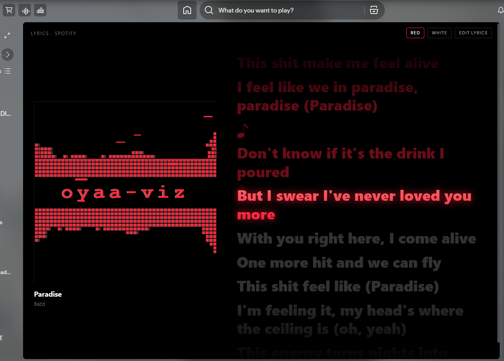

<!-- header -->

&nbsp;

<p align="center">
  
</p>

&nbsp;

<p align="center">
  
</p>

&nbsp;

<p align="center">
  <a href="https://github.com/oyaabol-1213/oyaa-viz/releases/latest"></a>
  <a href="https://github.com/oyaabol-1213/oyaa-viz/releases/latest"></a>
</p>

&nbsp;

---

### 👋 About me

- 🎧 I make custom apps for Spotify with **Spicetify**  
- 🔴 Currently shipping [**oyaa-viz**](https://github.com/oyaabol-1213/oyaa-viz), a glitch spectrum visualizer with karaoke lyrics  
- 🖤 I like simple designs, AMOLED black, and things that run smooth  
- 🛠️ Always tweaking, always learning

---



## Features

- Glitch spectrum visualizer with "oyaa-viz" inside, switch between **red** and **white**  
- Liquid Lyrics-style synced lyrics beside the oyaa visualizer, with a choice of **Karaoke** word timing or calmer **Block** display
- Optional persistent **ROMAN** toggle for Japanese, Korean, and Chinese lyrics, with karaoke timing retained
- Romanization is fetched from Google Translate only when enabled; the lyric text is sent to Google, not Spotify credentials, account details, or track IDs
- The glow pulses with the music, and flashes on every new word  
- **RED** / **WHITE** recolor the visualizer *and* the lyrics  
- Animated cover-art background with adjustable blur and opacity in **LIQUID LYRICS SETTINGS**
- **CINEMA** mode and dedicated **FULLSCREEN** viewing
- Liquid Lyrics **SYNC EDITOR** with text, block-sync, word-by-word karaoke sync, preview, undo, seeking, and timestamp nudging
- Persistent settings for lyric display, size, smooth scrolling, background, and per-track sync offset
- Per-song **sync offset** (− / + in the top bar) if the lyrics run early or late  
- Song has no lyrics? Create synced lyrics for it in the **SYNC EDITOR**
- Click any lyric line to jump to it  
- Pure black AMOLED background, light on resources

---

## Tutorial

### Before you start

You need **Spotify desktop** and **Spicetify** installed. If you don't have Spicetify yet, follow the [official guide](https://spicetify.app/docs/getting-started).

To check it works, open a terminal (PowerShell on Windows) and run:

```
spicetify -v
```

If it prints a version number, you're ready.

### Step 1: Download

1. Go to the [Releases page](https://github.com/oyaabol-1213/oyaa-viz/releases/latest).  
2. Under **Assets**, download `oyaa-viz-vX.X.X.zip`.  
3. Unzip it. You should see a folder named `oyaa-viz` with `index.js`, `style.css` and `manifest.json` inside.

### Step 2: Put it in CustomApps

Copy the whole `oyaa-viz` folder into your Spicetify `CustomApps` folder:

| System | Folder |
| :---- | :---- |
| Windows | `%appdata%\spicetify\CustomApps\` |
| Linux / macOS | `~/.config/spicetify/CustomApps/` |

Tip: on Windows, press `Win + R`, paste `%appdata%\spicetify\CustomApps` and press Enter to open it.

The path should end up like `CustomApps/oyaa-viz/index.js`. If it's `CustomApps/oyaa-viz/oyaa-viz/index.js`, you copied one folder too deep.

### Step 3: Enable it

Open a terminal and run:

```
spicetify config custom_apps oyaa-viz
spicetify apply
```

Spotify restarts, and you'll see the **oyaa-viz** icon in the left sidebar.

### Step 4: Use it

1. Play a song and open oyaa-viz from the sidebar.  
2. Press **RED** or **WHITE** to change the visualizer and lyric color. It remembers your choice.  
3. Lyrics from Spotify show automatically and follow the song.  
4. Click a lyric line to seek to that part of the song.  
5. Lyrics too early or too late? Use **−** / **+** in the top bar (0.1s per click). The number resets it. It is saved per song.
6. For Japanese, Korean, or Chinese lyrics, turn on **ROMAN** to show romanized text. The preference is saved. Romanization sends lyric text only to Google Translate; it does not send Spotify credentials, account details, or track IDs. Turning ROMAN off keeps the original script visible.
7. Open **SETTINGS** to adjust the animated artwork background, blur, opacity, lyric display style and size, scrolling, and per-track offset. **CINEMA** and **FULLSCREEN** provide the immersive views.

Romanization requests are opt-in and use Google Translate's public endpoint. Google receives the selected lyric text and detected source language to produce romanization. If the request fails, the original lyrics remain available.

### Create or edit synced lyrics

If a song has no lyrics, or you want to use your own:

1. Press **SYNC EDITOR** at the top right.
2. Paste your lyrics in **TEXT**, or edit the current track's lyrics.

**With timestamps (exact sync):**

```
[00:12.00] First line of the song
[00:16.50] Second line
[00:21.00] Third line
```

**Without timestamps (spread evenly across the song):**

```
First line of the song
Second line
Third line
```

3. Choose **Block Sync** to timestamp each line or **Karaoke Sync** to timestamp each word while the song plays. Press **ENTER** or **TAP** on each beat; click a timestamp to seek, and use **UNDO** or the nudge buttons to correct timing.
4. Review the result in **Preview**, then press **SAVE**. Your lyrics are saved locally for that song only.
5. To return to the live lyrics, open **SYNC EDITOR** and press **USE LIVE LYRICS**.

Word-level timing is saved in enhanced LRC format. If the Google romanization request fails, the original lyric text remains visible.

### Updating

1. Download the new zip from [Releases](https://github.com/oyaabol-1213/oyaa-viz/releases/latest).  
2. Delete the old `oyaa-viz` folder in `CustomApps` and copy in the new one.  
3. Run `spicetify apply`.

### Uninstalling

```
spicetify config custom_apps oyaa-viz-
spicetify apply
```

Then delete the `oyaa-viz` folder from `CustomApps`.

---

## Troubleshooting

**The app doesn't show in the sidebar** Make sure the folder is named exactly `oyaa-viz`, has `manifest.json` directly inside it, and that you ran `spicetify apply` after the config command.

**"Something went wrong" page** Update to the latest release. If it still happens, reset and re-apply:

```
spicetify restore backup apply
```

The app shows its own error text in red when something breaks. Please include that in an issue.

**Spotify updated and my apps disappeared** Spotify updates remove Spicetify changes. Run:

```
spicetify backup apply
```

**No lyrics show for a song** Not every song has live lyrics. Use **SYNC EDITOR** to create and time your own.

**Visualizer doesn't react to the music** The spectrum uses Spotify's audio analysis data. The top bar says `spectrum · analysis` when it is in use and `spectrum · generic` when it isn't. In generic mode it shows a steady pulse that also bumps on every sung word, so the lyrics still drive it.

---

### 🧰 Tools I use

<p>
  
  
  
  
  
  
</p>

&nbsp;

### 📊 GitHub stats

<p>
  
  
</p>

&nbsp;

---

<p align="center">
  </p>